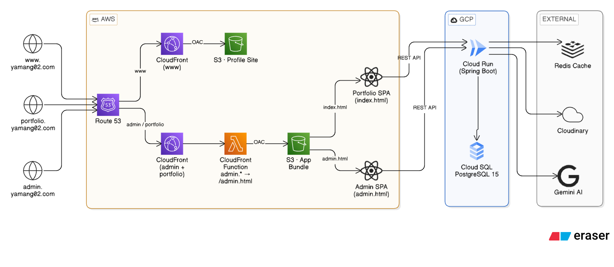

# AI Portfolio

Google Gemini API를 활용한 개발자 포트폴리오 AI 챗봇

- **프로필 랜딩**: https://www.yamang02.com
- **포트폴리오(SPA)**: https://portfolio.yamang02.com
- **어드민**: https://admin.yamang02.com

## 클라우드 아키텍처



## 로컬 개발

프론트엔드는 Vite 로컬 서버로 실행하고, 백엔드와 PostgreSQL·Redis는 `backend/`의 Compose 설정으로 실행합니다.

```bash
# backend/.env.example을 backend/.env로 복사하고 필요한 값을 설정
cd backend

# 백엔드·PostgreSQL·Redis 시작
docker compose up -d postgres redis backend

# 별도 터미널에서 프론트엔드 실행
cd frontend
pnpm install
pnpm run dev
```

접속 정보: 프론트엔드 `localhost:3000` / 백엔드 API `localhost:8080`

## 연락처

- **이메일**: ljj0210@gmail.com
- **GitHub**: https://github.com/Yamang02
